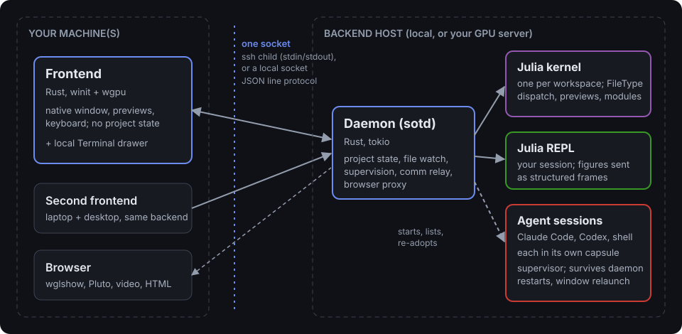

# Architecture at a Glance

Ship of Tools is **a frontend, a backend daemon, and two kinds of Julia process (a kernel and your REPL)**. The
frontend and the daemon talk over a socket, even when everything runs on one machine. This page covers what each process owns, why the
split falls where it does, the one serialization seam between Rust and Julia, and
how the same architecture runs a remote project with almost no extra plumbing.

## The processes

| Process | Language | Owns |
|---------|----------|------|
| Frontend | Rust (winit + wgpu) | the native window, chrome, preview rendering, keystrokes. Stateless about the project — it renders what the backend sends and forwards input. |
| Backend daemon | Rust (tokio) | project state, file watching, process supervision of the kernels and the REPL, starting and listing the agent sessions' capsules, the comm relay. Exposes a JSON line protocol to the frontend. |
| Julia kernel | Julia | the `FileType` dispatch table and Julia-aware previews, project scans (the Modules tree), the file content hash behind the drift check. Reads your sources statically; it never runs your code and never loads your project's environment. |
| REPL | Julia | your interactive session, supervised by the backend and run in your project's environment, with a display shim that emits structured frames (stdout, stderr, value, image, error) over stdio. |
| Capsule | Rust | one per agent session: supervises the agent on a real terminal and records it. The daemon starts and lists capsules but does not hold them up. |

The frontend holds no project knowledge. The backend is the single owner of
project state and the one protocol entry point. The Julia kernel is where every
extensible, Julia-aware decision is made. The REPL is a separate process so a
crash or a long computation in your interactive session never takes down the
daemon that supervises it.

## Why client/server, even on one machine

The frontend and the daemon communicate over a socket locally exactly as they would
across a network. That looks like overhead on a single box, but the same protocol serves local and remote; only the transport differs. The plumbing cost is paid once, up front, instead of being
retrofitted later when local-only assumptions have already hardened.

This directly serves a requirement: local and remote operation must offer the
*same* user experience. A design that special-cased "local" would have to grow a
second path for "remote" and keep the two in sync forever. One socket-based
protocol avoids that split entirely.

## Why the language split

The boundary between Rust and Julia is not arbitrary — each language does what it
is best at.

**Rust is for plumbing.** Rendering, IPC, file watching and process supervision
all want a single statically-linked,
cross-platform binary with predictable performance. `tokio`, `notify`, `winit`,
and `wgpu` cover that stack. Keep this layer boring and predictable; it should
rarely need to change when the feature set grows.

**Julia is for everything plugin-extensible and Julia-aware.** `JuliaSyntax.jl`
parses Julia source — it is the parser the language itself uses. More fundamentally, the plugin
mechanism is *multiple dispatch*: a small set of
abstract types whose methods are the extension ABI. That only works in Julia. See
[The Dispatch ABI](../extend/abi.md).

## The serialization seam

The seam between Rust and Julia is JSON frames over stdio. For a preview the kernel returns a MIME type, the bytes and
an `extras` map, and the window picks a renderer by MIME without learning file types. Trees are built in Rust; the
Modules tree comes from the kernel's project scan. The consequence is that **adding a new `FileType` needs no Rust
change** when it returns a MIME the window already renders, unless its output must be bounded, in which case the
daemon's preview gates also name its extensions (`Mode` is not built: the modes are native Rust views today). See
[`PreviewPayload`](@ref) in the API reference.

## Deployment topology

The architecture's payoff shows up in the standard remote deployment: a Windows
or local frontend driving a Linux backend where the Julia kernel and GPU live.

- The **backend runs as a long-lived daemon on the remote** — the
  `systemd --user` unit `sotd.service` — so it survives SSH disconnects.
- It listens on a **per-user Unix socket**, not a host-allocated TCP port.
- The **frontend spawns its own `ssh` child** running `sotd stdio-bridge` on
  the remote and speaks the same JSON line protocol over its stdin/stdout — no
  forward, no local port. See [Transport](../concepts/transport.md).
- On reconnect (after a laptop sleep, a wifi flap, or a fresh client), the
  frontend re-attaches by **session id**; the REPL, which holds your variables and loaded modules, lives in
  the daemon and keeps them across the gap, and an evaluation still running keeps running and shows again in the
  drawer.

A single daemon can host **one Julia kernel per workspace**, routed by
`workspace_id`, so switching the active project is fast and never tears the kernel
down. Each agent session runs in its own **capsule** supervisor, which the
daemon starts and lists but does not hold up, so sessions survive a window relaunch and
daemon restarts; closing the last window on a computer ends its sessions unless you keep them. See
[Sessions and persistence](../concepts/sessions.md).

Everything the daemon starts except capsules ends with it. On Linux a small guard process ends them within seconds of
the daemon's end, even when the daemon is killed, and a Pluto server's notebook workers, and a process your code starts
in the REPL detached, end with the server's or the REPL's own display, so a crashed Pluto server leaves none behind; on
a host without Xvfb they end when the daemon ends. macOS has no guard: only a normal end of the daemon ends its
children there, and not a process that left a child's process group, such as a Pluto notebook worker.

## Where to go next

- [Modes](modes.md) — the switchable nav-tree roots over the same code.
- [Previews](previews.md) — which file types render, and at what fidelity.
- [The Dispatch ABI](../extend/abi.md) — how multiple dispatch is the plugin system.
- [Frontend Rendering](../design/rendering.md) — how previews are drawn into the window.
- [Backend & Sessions](../design/backend.md) — daemon internals and session lifecycle.
- [The Line Protocol](../design/protocol.md) — the JSON wire format between the processes.
